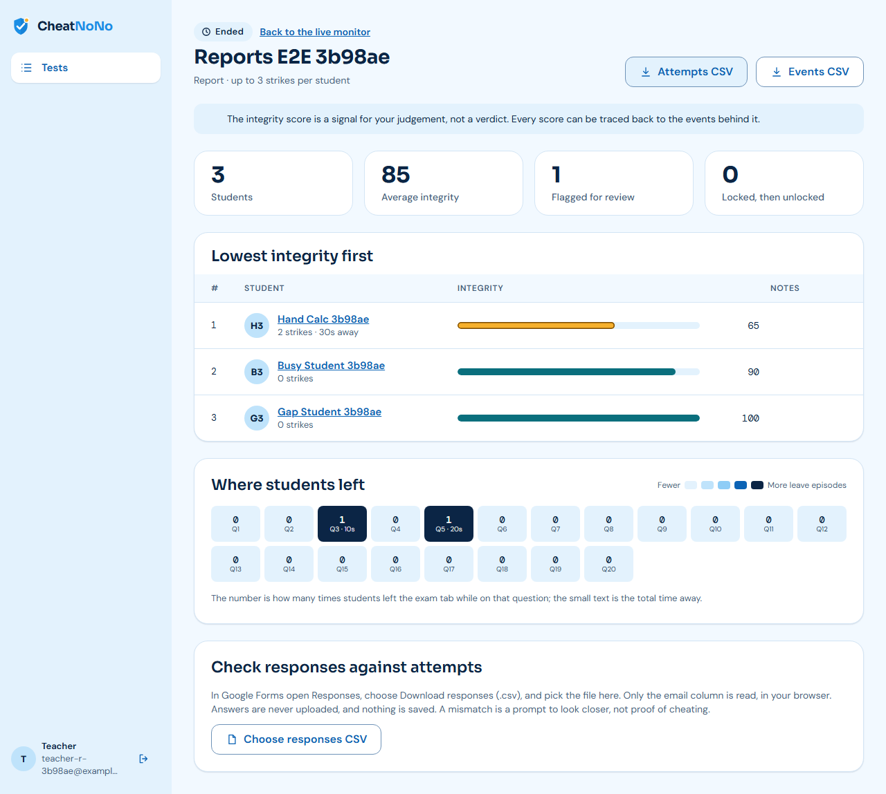
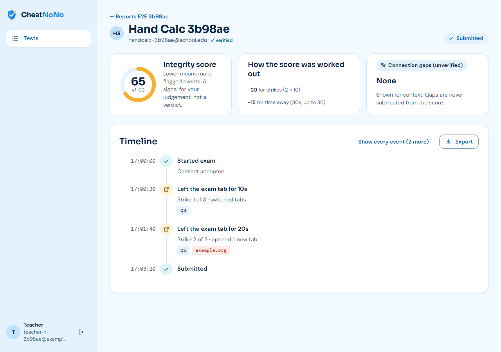
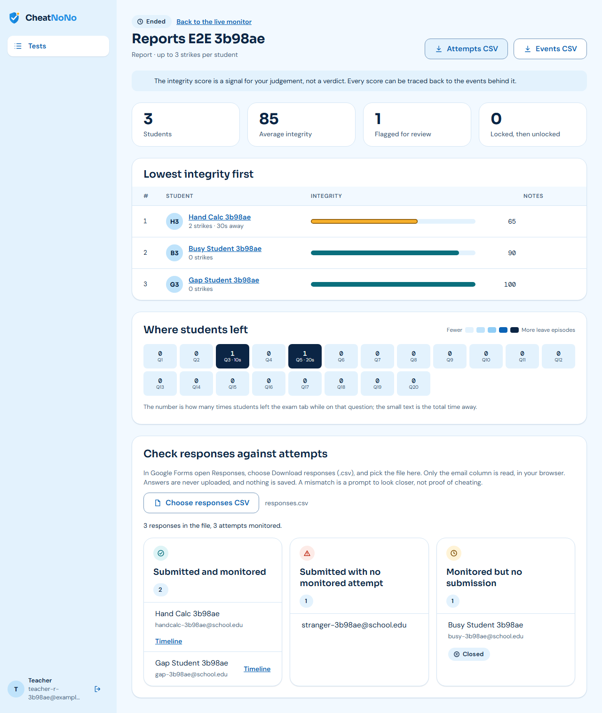
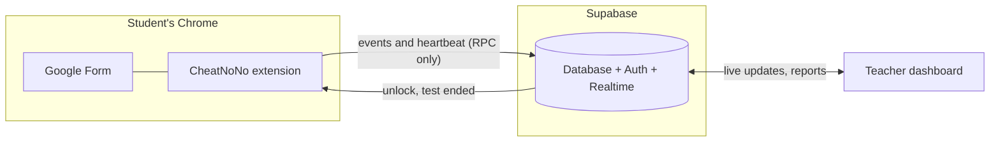

<div align="center">


# CheatNoNo

### Fair exams, calmly kept.

An anti-cheat companion for **Google Forms** exams. A Chrome extension watches the exam, a live dashboard
shows the teacher what is happening, and a report afterwards explains it, with evidence tied to specific questions.

[**Open the dashboard**](https://cheatnono.vercel.app) &nbsp;·&nbsp; [For teachers](#for-teachers-run-a-protected-exam) &nbsp;·&nbsp; [For students](#for-students-take-a-protected-exam) &nbsp;·&nbsp; [Deploy it](DEPLOY.md) &nbsp;·&nbsp; [Develop](#for-developers)


</div>

---

## Why CheatNoNo

Teachers who run exams on Google Forms have two bad options. Lockdown apps are heavy, need an install per operating
system and tell you only that a student "did something". Doing nothing leaves the exam on the honour system.

CheatNoNo sits in between. It works **inside Chrome, on any computer**, with nothing for the teacher to install. It treats
leaving the exam as **evidence**: when it happened, for how long, where the student went and which question they were on.
It never calls anyone a cheater. It gives the teacher a calm, explainable record and leaves the judgement to them.

- **Fair by design.** Clear rules shown up front, a strike ladder with warnings, and a score that is explicitly a prompt to review, not a verdict.
- **Private by design.** It logs the *domain* of a site, never page content. It never reads answers or keystrokes, and it only runs during a protected exam.
- **Free to run.** No Google sign-in, no Google Forms API, no paid service. It runs on a free Supabase project and any static host.

## What you get

| For students | For teachers |
| --- | --- |
| A short **consent screen** that says exactly what is and is not monitored | Paste a Form link, press **Go live**: a protected exam in about a minute |
| A visible **strike counter** and calm, plain-language warnings | **Live monitor**: status, strikes, current question and last seen for every student, updating in seconds |
| **Warning, then blur, then pause**: three strikes lock the exam until the teacher unlocks it | One-click **Unlock**, and an alert feed of strikes and locks as they happen |
| Answers are never touched, and a lock never loses them | **Student timeline** with an integrity score, a breakdown of every point, and question numbers |
| Resumes where they left off after a crash or browser restart | **Class report**: ranked scores, a heatmap of where students left, CSV export |
| An honest note when the connection drops, never a penalty | **Reconciliation**: upload the Forms responses file and find anyone who submitted without being monitored |

Also included: blocklist of AI assistants, search and messaging sites (with a teacher allow-list for tools like a calculator),
required fullscreen, blocked copy, paste and right-click, snap-back to the exam tab, a record-only mode that watches without
blocking, and an **End test** flow that tells students the exam is closed and flags any late submission.

## See it

<table>
<tr>
<td width="50%"></td>
<td width="50%"></td>
</tr>
<tr>
<td align="center"><sub><b>Class report.</b> Lowest scores first, and a heatmap of where students left the exam.</sub></td>
<td align="center"><sub><b>Student timeline.</b> Every point of the score traced back to an event.</sub></td>
</tr>
</table>



<sub>The screenshots show demo data from the automated test suite.</sub>

## How it works



1. The teacher turns a Google Form into a protected test in the dashboard and goes live.
2. When a student opens the Form, the extension asks for consent, then starts a session.
3. Every time the student leaves the exam (another tab, another window, the browser), that is **one episode and one strike**. The extension snaps them back, shows the warning ladder, and records the episode with its duration and question.
4. The dashboard shows it live. The teacher can unlock a locked student.
5. Afterwards, the report scores each attempt from its events and the reconciliation catches anyone who was never monitored.

Students are anonymous Supabase users and can only write through checked database functions, never directly to tables.
Teachers see only their own tests, enforced in the database.

## For teachers: run a protected exam

> You need the dashboard address (for example https://cheatnono.vercel.app) and a Google Form. Nothing to install.

**1. Create your account.** Open the dashboard, choose **Create an account**, and confirm your email, then sign in.

**2. Prepare the Google Form.** In Forms, open **Settings, then Responses** and turn on:
- **Limit to 1 response**
- **Collect email addresses: Verified**

Then click **Send**, choose the link tab and copy the link. It must look like `docs.google.com/forms/d/e/…/viewform`.
The editor link will not work, and the dashboard tells you if you paste it.

**3. Add the test.** Click **Add test**, paste the link, give it a title and choose the rules: number of strikes,
blocked sites, allow-list, fullscreen, copy and paste. Choose **Enforce** (warnings and locks) or **Record only**
(watches silently, never interrupts).

**4. Go live.** Click **Go live** and tick the two Google Forms checkboxes. Share the **same Google Form link** with
your students, along with the [student steps](#for-students-take-a-protected-exam).

**5. Watch the exam.** The live monitor shows each student's status, strikes and question. A locked student gets an
**Unlock** button. Click it and their exam opens again within about 5 seconds.

**6. End the test.** In Google Forms turn off **Accepting responses**, then click **End test** in the dashboard. It shows
how many students are still working and warns that unsubmitted answers will be lost.

**7. Review.** Open **Report**:
- **Lowest integrity first** shows who to look at. Click a name for their timeline.
- **Where students left** shows the questions that drew students out of the exam.
- **Attempts CSV** and **Events CSV** open in Sheets and Excel.
- **Choose responses CSV**: download the responses from Google Forms and drop the file in. In your browser only, it compares emails and lists three groups: *submitted and monitored*, *submitted with no monitored attempt* and *monitored but no submission*. Answers are never uploaded.

> The integrity score is a signal for your judgement, not an automatic verdict. Every score can be traced to the events behind it.

## For students: take a protected exam

> Use **Google Chrome on a laptop or desktop**. Phones and other browsers can't run the extension.

**One-time setup (about a minute)**
1. Download the CheatNoNo folder your teacher gave you and **unzip it somewhere permanent**. Don't move or delete it afterwards.
2. In Chrome, open `chrome://extensions` and turn on **Developer mode** (top right).
3. Click **Load unpacked** and choose the unzipped folder, the one that contains `manifest.json`.
4. On the CheatNoNo card, click **Details** and turn on **Allow in incognito**.

**Taking the exam**
1. Open the exam link from your teacher. Make sure you are signed in to Google.
2. Read the **Before you begin** screen. It lists exactly what is monitored. Type your name and email, tick the box and press **Start exam**. The exam opens in fullscreen.
3. Stay in the exam tab. A small badge shows your strikes, like `1/3`.

**What happens if you leave the exam**

| Strike | What you see |
| --- | --- |
| 1 | A friendly warning: "You left the exam tab." Press **Continue exam**. |
| 2 | A final warning. Questions are hidden until you press **Return to exam**. |
| 3 | The exam pauses. Keep the tab open and wait for your teacher to unlock it. Your answers are saved. |

Opening a blocked site (such as an AI assistant) counts as leaving. If your browser crashes, reopen the exam link and
you carry on where you were. If your internet drops, nothing is held against you.

**What CheatNoNo does and does not see**
- It sees: when you leave the exam tab and for how long, the *domain* of sites you open, leaving fullscreen, and copy or paste attempts.
- It never sees: your answers, what you type, the content of other pages, your webcam or your screen.
- If you click **I don't agree**, nothing is recorded and you should contact your teacher.

## Integrity score

The score starts at 100 and goes down. A teacher can see every subtraction.

| Signal | Penalty |
| --- | --- |
| Each strike (leave episode) | -10 |
| Each second away | -0.5, up to -30 in total |
| Opening a blocked site | -15 |
| Returning, then moving to another question within 10 s | -5 |
| Copy, paste or devtools attempt | -2 each, up to -10 in total |
| Connection gap | 0, shown as "connection gap (unverified)" |

Example: 2 strikes and 30 seconds away gives 100 - 20 - 15 = **65**. Bands: 85 and above is fine, 60 to 84 is worth a
look, below 60 needs review. The test suite checks this exact calculation.

## Honest limits

CheatNoNo is a deterrent and an evidence trail, not a fortress.

- A browser extension can't stop a student using a **second device or a phone**. It logs the time they spent away, and the timeline and heatmap make that visible.
- A student who **doesn't install the extension, or turns it off**, isn't monitored. That is why the reconciliation exists: it lists everyone who submitted without a monitored attempt.
- The lock is enforced by the extension, not the server. It can't stop someone who removes the extension.
- Short focus losses count (there is no grace period), so an OS notification that steals focus can cost a strike. The timeline shows durations so the teacher can judge.
- Google Forms markup is unofficial, so the current-question number is best effort.

More detail is in [docs/MANUAL_TESTING.md](docs/MANUAL_TESTING.md).

## Product principles

These shape what is, and is not, built:

- **No messaging** between teacher and students, and **no accusations** in student wording.
- **No Google sign-in or Forms API.** Students type a name and email. Teachers use email and password.
- **Consent first.** Refusing consent isn't a strike and records nothing.
- **Gaps are shown, not punished.** Offline time never lowers a score.
- **Data is the teacher's.** A teacher can delete a test's data. A 180-day retention policy is the default (automatic deletion is planned).

The full requirements and decision log are in [PRD.MD](PRD.MD).

## Deploy it yourself

Hosted Supabase project, the dashboard on Vercel (or Netlify, Cloudflare Pages), and the extension folder you hand to
students. The full step-by-step guide, with the environment files, is **[DEPLOY.md](DEPLOY.md)**.

## For developers

**Stack:** Chrome extension (Manifest V3, plain modern JavaScript, bundled with esbuild) · Supabase (Postgres, Auth,
Realtime, row-level security, `security definer` functions) · teacher dashboard in React and Vite · design system in
[CheatNoNo/](CheatNoNo/).

```text
extension/        Chrome extension (service worker, content scripts, backends)
  src/shared/     pure helpers shared with the dashboard (form parsing, integrity score)
dashboard/        teacher dashboard (React + Vite)
supabase/         migrations, seed and database tests (pgTAP)
CheatNoNo/        design tokens, screens and component blueprints
tests/e2e/        Playwright end-to-end tests
docs/             manual testing checklist and screenshots
```

```bash
# local stack (needs Docker Desktop and the Supabase CLI)
supabase start && supabase db reset

# extension: build against the local stack, then load extension/dist unpacked
npm --prefix extension install && npm --prefix extension run build

# dashboard on http://127.0.0.1:3000
npm --prefix dashboard install && npm --prefix dashboard run dev

# tests
npm --prefix extension test && npm --prefix dashboard test      # unit tests
supabase test db                                                 # database policies and functions
python tests/e2e/run_e2e.py                                      # extension, mock backend
python tests/e2e/run_e2e_supabase.py                             # extension against the real database
python tests/e2e/run_e2e_dashboard.py                            # teacher dashboard, two teachers and a live student
python tests/e2e/run_e2e_reports.py                              # score, timeline, CSV and reconciliation
```

The headed end-to-end tests take over a Chrome window for several minutes. Don't click or close it while they run.
Working rules for contributors are in [CLAUDE.md](CLAUDE.md).

## Status

| Milestone | Scope | State |
| --- | --- | --- |
| M1 | Extension: detection, strikes, lock, consent | Done |
| M2 | Supabase backend, resume after restart | Done |
| M3 | Teacher dashboard: tests, go live, live monitor, unlock, end test | Done |
| M4 | Timeline, integrity score, report, heatmap, CSV, reconciliation | Done |
| M5 | Student onboarding page, Chrome Web Store listing, PDF export, automatic data retention, accessibility review | Next |
